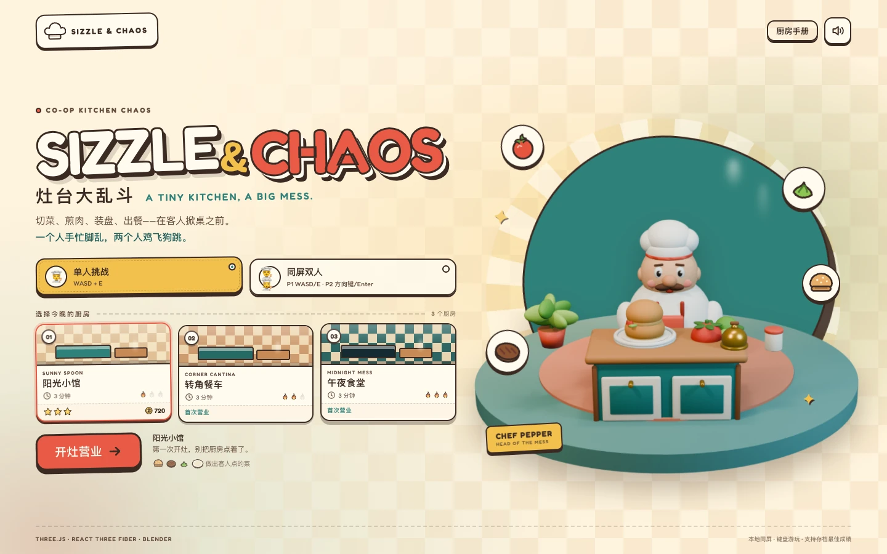
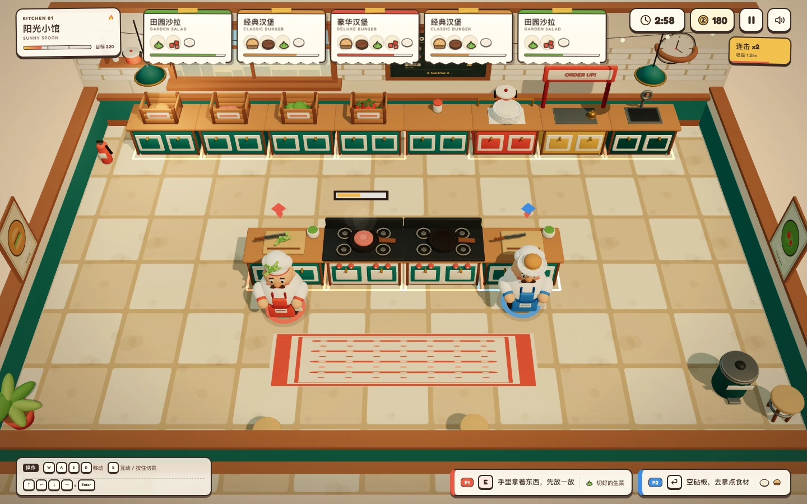
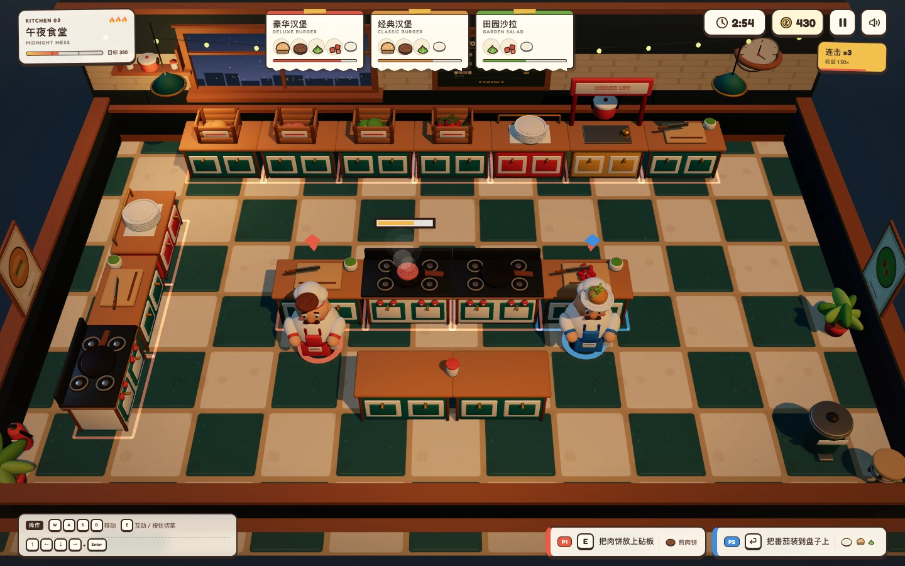
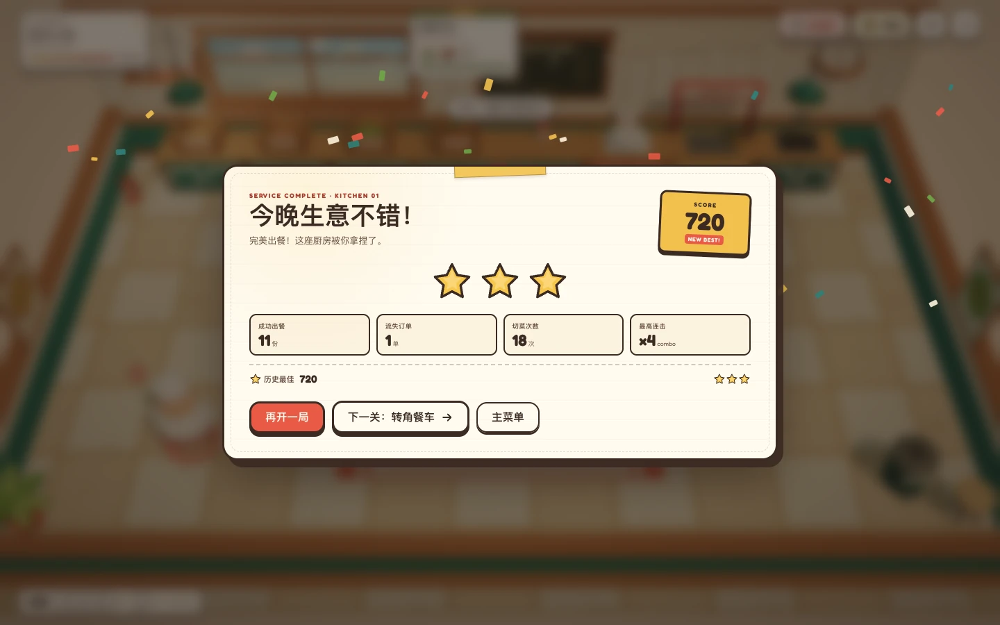
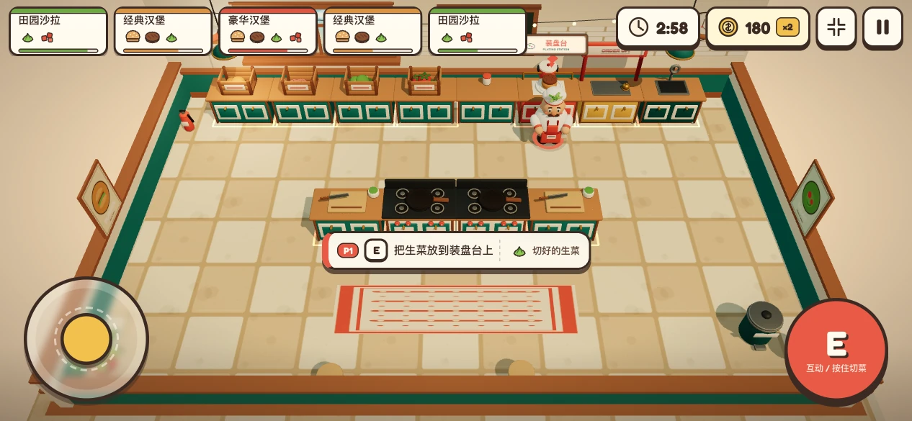

# Sizzle & Chaos · 灶台大乱斗

[](https://github.com/tuxin-openclaw/sizzle-and-chaos/actions/workflows/deploy-pages.yml)

> 一款 Overcooked 风格的原创同屏厨房派对游戏。切菜、煎肉、装盘、出餐——在客人掀桌之前。
>
> **Three.js + React Three Fiber + Blender** · React 19 · TypeScript · Vite



## 亮点

- **3 间风格不同的厨房**：阳光小馆、转角餐车、午夜食堂。不同动线、主题配色与订单节奏。
- **单人 / 同屏双人**：P1 键盘 WASD + E，P2 方向键 + Enter，也可以一人玩。
- **完整的厨房循环**：货箱取料 → 砧板按住切菜 → 煎锅烹饪 → 拿盘子装盘 → ORDER UP 出餐。
- **会变焦的肉饼、会流失的订单、会累积的连击**：熟度计时、订单耐心、连击收益与超时罚分。
- **手工感的 3D 美术**：Blender 建模的低多边形厨师、食物与店铺道具；Three.js 实时灯光、阴影、蒸汽、火焰和粒子。
- **纯程序化音频**：WebAudio 合成的餐馆摇摆乐与切菜/油锅/出餐音效，无外部音频文件。
- **响应式与触屏**：移动端横屏会显示虚拟摇杆和互动按钮；竖屏会先提示旋转设备。
- **全屏与 PWA**：手机开始游戏时自动尝试进入全屏，界面内也有全屏按钮；支持安装到主屏幕，安装后以全屏 App 模式启动。
- **移动端紧凑订单栏**：订单自动变成单行迷你票据，最多 5 单也能放在顶栏右侧，不再遮住半个厨房。
- **本地最佳成绩**：完成一局后自动把分数和星级存进 `localStorage`。

| 厨房实战 | 午夜食堂 |
| --- | --- |
|  |  |

| 打烊结算 | 移动端横屏 |
| --- | --- |
|  |  |

## 快速开始

要求：Node.js 22+，npm 10+。

```bash
npm install
npm run dev
```

> GitHub Pages 部署地址：**https://tuxin-openclaw.github.io/sizzle-and-chaos/**（首次 Actions 构建完成后生效）

打开终端输出的地址（默认 `http://localhost:5173`）。生产构建：

```bash
npm run build
npm run preview
```

模型、菜单主视觉、字体都已打包进项目，**不需要安装 Blender 也能直接游玩**。

## 操作

| 动作 | P1 | P2 |
| --- | --- | --- |
| 移动 | `W` `A` `S` `D` | `↑` `←` `↓` `→` |
| 互动 / 按住切菜 | `E` | `Enter` |
| 暂停 | `Esc` 或 `P` | 同左 |
| 静音 | `M` 或右上角按钮 | 同左 |

- 单人模式下也可以用方向键移动 P1。
- 触摸端：左下虚拟摇杆移动，右下圆形按钮互动；按住按钮切菜。
- 建议使用桌面浏览器或移动端横屏；移动端竖屏会显示旋转提示。

### 手机全屏

- **Android Chrome / Edge**：开始游戏时会自动请求全屏并尝试锁定横屏；右上角的 ⛶ 按钮可以随时切换。
- **iPhone / iPad**：Safari 不允许普通网页隐藏地址栏。请点 Safari 的「分享」→「添加到主屏幕」，再从主屏幕图标启动；这样会以独立全屏 App 运行。菜单和游戏内都有 iPhone 全屏指引入口。
- 项目包含 `manifest.webmanifest`、应用图标和 Service Worker，可从 Chrome 菜单「安装应用 / 添加到主屏幕」安装，并在首次加载后获得离线缓存。

## 怎么玩

1. **看懂订单**：屏幕上方票据显示配方、食材图标和剩余耐心，倒计时结束会流失订单并扣分。
2. **拿盘子**：到盘子架按互动键，手里会端着一个空盘。
3. **备料**：货箱可取面包、肉饼、生菜、番茄。生菜/番茄/肉饼需要放到砧板上，**按住互动键**切碎。
4. **煎肉**：把切好的肉饼放进煎锅。它会在约 4 秒后煎熟，之后继续放置会变焦；焦掉的肉饼只能丢进垃圾桶。
5. **装盘**：端着盘子走到砧板或煎锅旁，按互动键把成品装进盘子。盘子上的食材必须和订单完全一致。
6. **出餐**：到红色 **ORDER UP!** 窗口按互动键。越早送达，时间奖励越高；连续出餐会叠加连击倍率。

### 菜谱

| 菜品 | 配方 |
| --- | --- |
| 田园沙拉 | 切碎生菜 + 切碎番茄 |
| 经典汉堡 | 面包 + 煎肉饼 + 切碎生菜 |
| 豪华汉堡 | 面包 + 煎肉饼 + 切碎生菜 + 切碎番茄 |

每间厨房的订单池和耐心不同：阳光小馆更宽松，午夜食堂的客人最急。

## 技术实现

### 前端

- **React 19 + TypeScript + Vite 8**：UI、路由式的界面切换和构建。
- **Three.js · @react-three/fiber · @react-three/drei**：场景、相机、灯光、阴影、GLB 加载、Billboard、Sparkles 等。
- **自定义游戏循环**：`src/game/engine.ts` 中维护玩家、站点、订单、计时和交互状态，并在每帧处理基于圆形碰撞体与 AABB 的移动碰撞、切菜进度、烹饪熟度和订单结算。
- **两套状态订阅**：高频的玩家位置直接在 `useFrame` 里驱动 3D 对象；HUD 以约 10Hz 的快照刷新；物品/站点结构变化则通过 version 订阅触发 React 重渲染。避免每帧重渲染整个界面。
- **程序化纹理**：地板、地毯、黑板、窗景、海报、时钟、接缝 UI 图形等都由 Canvas 2D 生成，见 `src/scene/textures.ts`。
- **程序化音频**：`src/game/audio.ts` 使用 WebAudio 振荡器、噪声和滤波器合成背景乐与音效；在首次用户点击后启动，符合浏览器自动播放策略。

### 目录

```text
src/
  assets/          # 主视觉与本地字体（Fredoka + OFL 许可）
  game/
    engine.ts        # 游戏循环、碰撞、交互、订单、计分
    data.ts          # 菜谱、食材、三关地图与主题
    types.ts         # 共享类型
    audio.ts         # WebAudio 音乐与音效
    progress.ts      # localStorage 最佳成绩
    useGameHooks.ts  # HUD 快照 / 键盘控制 hooks
  scene/
    GameScene.tsx    # Canvas、灯光、相机、游戏循环挂载
    Kitchen.tsx      # 厨房房间、操作台、站点和装饰
    Chef.tsx         # 厨师模型、行走/切割/搬运动画
    models.tsx       # GLB 加载、材质换色、食物/盘子堆叠
    effects.tsx      # 进度条、站点高亮、蒸汽、火焰、碎屑
    textures.ts      # 程序化 Canvas 纹理
  ui/
    MainMenu.tsx     # 主菜单、模式、关卡选择
    HUD.tsx          # 订单票据、计时、分数、上下文提示
    Overlays.tsx     # 加载、倒计时、暂停、结算、厨房手册、竖屏提示
    TouchControls.tsx# 移动端摇杆与互动按钮
public/
  models/            # Blender 导出的 GLB（chef / food / stations / props）
  icons/             # PWA / Apple Touch 图标
  manifest.webmanifest
  sw.js              # 生产环境 Service Worker（离线缓存）
scripts/blender/
  build_assets.py    # 全量建模 + 导出 GLB
  render_hero.py     # 渲染菜单主视觉
```

## Blender 资产管线

建模不是手工 .blend 文件，而是**可复现的 Blender Python 脚本**。使用 **Blender 4.5.9 LTS** 开发并导出。

```bash
# 需要安装 Blender 4.5+ 并确保 blender 在 PATH 中
npm run assets:build
npm run assets:hero
```

- `scripts/blender/build_assets.py` 会生成：
  - `chef.glb`：厨师（含可独立旋转的手臂节点、帽子、围裙、面部）。
  - `food.glb`：盘子、面包、肉饼、整颗/切碎生菜、整颗/切碎番茄、碗。
  - `stations.glb`：普通操作台、煎锅灶台、砧板台、盘子台、出餐口、水槽。
  - `props.glb`：木箱、平底锅、刀、垃圾桶、植物、高脚凳、吊灯、铃铛、搪瓷锅、灭火器、罐子。
- 约定：Blender Z-up，模型正面朝 `-Y`；对象原点位于底部中心，因此导入 Three.js 后可以直接落地，无需补偿偏移。glTF 导出会自动转换为 Three.js 的 Y-up / +Z 朝向。
- 材质全部使用 Principled BSDF 的输出色；导出时保留材质名称，运行时按材质名替换玩家专属颜色（红/蓝围裙）。
- 菜单主视觉 `src/assets/hero-chef-trimmed.png` 由 Blender 渲染后裁掉透明边距得到；`scripts/blender/render_hero.py` 输出原始透明图 `hero-chef.png`。

## 质量验证

在 macOS / Chrome（Playwright，headless）上验证：

- `npm run build` 通过（TypeScript + Vite）。
- 生产预览无 console error、无失败网络请求。
- 1440×900 下实时场景约 60 FPS。
- 已逐个验证：单/双人移动与碰撞、取盘、货箱取料、按住切菜、肉饼下锅/煎熟/焦糊、装盘、出餐、订单超时扣分、连击、暂停/继续/重开、下一关、最佳成绩持久化、触屏摇杆与按钮、竖屏旋转提示。
- `npm run lint` 0 error（仅有少量 React Compiler 对 R3F 每帧可变对象的提示）。

## 已知边界

- 只支持本地同屏双人，没有联网。
- 触屏操作只控制 P1，适合单人移动端；双人仍推荐键盘。
- 没有洗碗/脏盘子系统，盘子供应无限；这是为了保持单局节奏而做的简化。
- 关卡全解锁，便于试玩；最佳成绩按关卡保存。
- iOS Safari 无法通过网页 API 隐藏地址栏；iPhone 用户需要按上述步骤将它添加到主屏幕，才能获得真正的全屏体验。

## 版权与致谢

本作是受 Overcooked 系列启发的原创小品，没有使用该系列的任何美术、音频或代码资产。厨师、厨房、食物与道具均由本项目中的 Blender 脚本生成；纹理、音乐和音效均由代码实时生成。字体使用 **Fredoka**（SIL Open Font License，许可证见 `src/assets/fonts/OFL.txt`）。


## 部署到 GitHub Pages

仓库已配置 `.github/workflows/deploy-pages.yml`：每次推送到 `main` 会自动构建 `dist` 并通过官方 Pages Actions 部署。

- 站点：https://tuxin-openclaw.github.io/sizzle-and-chaos/
- 仓库：https://github.com/tuxin-openclaw/sizzle-and-chaos
- 构建时的 base 自动使用仓库名（GitHub Actions 中的 `GITHUB_REPOSITORY`）；也可以手动覆盖：

```bash
VITE_BASE=/my-repo/ npm run build
```
